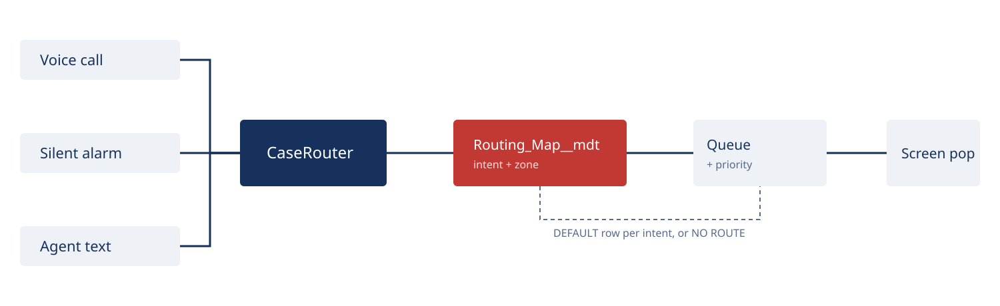
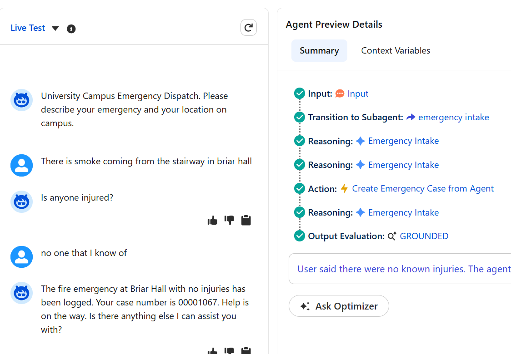
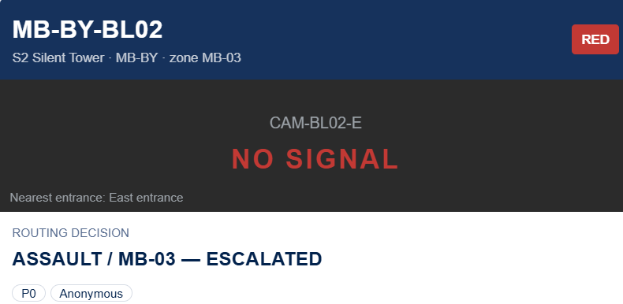
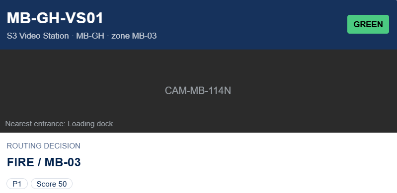
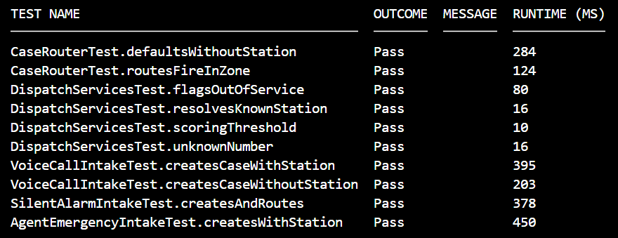

<!-- _class: lead -->
<!-- _backgroundImage: url('img/hero.jpg') -->
<!-- _backgroundSize: cover -->
<!-- _backgroundOpacity: 0.6 -->
# From PoC to go-live

### Additions to the campus emergency PoC

**Daniel Cadwell** · Salesforce architect-developer

Photo: geraldlangphotography / Pixabay

<!-- Speaker notes: frame this in the first sentence. "I haven't seen your PoC. This isn't a
replacement — it's the parts between where a PoC usually stops and where a campus can
actually run it. I built working versions of the hard ones so you can judge the skill,
not the slide." -->

---

## What a campus emergency line has to do

- Answer a caller who may be panicking, and may not know where they arep
- Take an alarm from a blue-light station with nobody on the line
- Decide in seconds which team goes, and how urgent it is
- Put the location, the camera and the decision in front of a dispatcher
- Escalate when nobody picks it up
- Bridge to 911 when campus response isn't enough

<!--
Read the list, don't embellish. Every line is a requirement with a build consequence —
say that at the end. "Each of these is a feature, and each has a cost."
-->

---

## Where a PoC stops

| PoC | Go-live |
|:--|:--|
| Intent as a picklist | Classified from speech |
| Hard-coded queue names | Routing table, editable without deploy |
| Case created, owner set | Owner set, dispatcher alerted, unclaimed work escalated |
| One happy path | Fallback, fault paths, empty states |
| Demo data | Permission model, agent user, audit |

<!--
This is the slide that earns the interview. Name which column their PoC is probably in,
and say you'd want to see it before committing to a plan. Don't hedge — they know.
-->

---

## What this demo proves

Working, in a Developer Edition org, in two days:

- Metadata-driven routing with per-intent fallback
- Three entry points: simulated voice, silent alarm, and an Agentforce agent
- Dispatcher screen pop with station, camera and the rule that fired
- Unclaimed P0 escalation on a timer
- 10 test methods, all passing

<!-- Speaker notes: two days is the number that matters. It's the argument that adding to
their PoC is weeks, not quarters. -->

---

## Architecture

<!-- Speaker notes: three doors, one router. The router is the only place that decides
anything, so behaviour is auditable in one place. -->

---

## The silent alarm

- Fixed duress button, wall-mounted, basement lab reception
- Pressed instead of a phone: talking tells the intruder someone's been called
- The payload is a station ID and nothing else — no caller, no description, no one to ask
- Intent is inferred from the device, not captured: duress → ASSAULT → P0
- Gap: the device-to-intent map should be config, one row per device class

<!-- Speaker notes: this is the slide that stops the "why is an alarm an assault"
question before it starts. A duress button exists for one situation — a person being
confronted now. Say that. Then say the honest part: the flow currently assumes duress
because there's only one silent device class in the build. -->

---

## Routing is data

- Eight rows of intent + zone → queue + priority
- Exact match, then the DEFAULT row per intent, then NO ROUTE
- Changing a destination is a metadata edit, no deployment
- Demoed live: ASSAULT/MB-03 moved to another queue, the Case rerouted

<!--
This is the slide a facilities stakeholder cares about most. They can remap without a
release. Say that word — release — because it's the thing they're afraid of.
-->

---

## The agent

- Agentforce Service Agent, one subagent, one action
- Classifies free text into five intents, collects location and injury
- Creates and routes the Case, reads the number back
- Messaging today; the same topic takes ASR output when Connect lands

<!-- Speaker notes: be explicit that it's messaging, not voice. The classifier is the piece
that makes the voice leg possible later. -->

---

## The screen pop

- Station, class, building, zone, health badge
- Camera tile, blacked out with NO SIGNAL when the station is down
- The rule that fired, priority, privacy flags
- Empty state when no station resolved

 

<!--
A dead camera has to be visible at dispatch, not discovered later. The badge is the
feature. Point at the NO SIGNAL tile as you say it.
-->

---

## The voice call

- Inbound call; DNIS resolves the building before anyone speaks
- Dispatcher captures intent — callers can't classify themselves
- Score weights intent, injury and asset class into a severity
- Station health sets the panel state; it never decides the route

<!-- Speaker notes: the contrast with the previous slide is the point. Silent has no
human, so intent is inferred. Voice has a human, so intent is captured. Same router,
same table, two very different information problems. -->

---

## Escalation and 911

- P0 unclaimed after two minutes → re-owned to a named dispatcher, decision stamped
- Campus dispatch is the tenant; 911 is a dispatcher bridge, not an auto-dial
- 911 needs a human on the line, a callback ANI and a dispatchable address

<!--
Campus police reach a campus building faster than a PSAP and hold the keys and the
cameras. But campus-first must never become campus-only. The 911 bridge is a dispatcher
action on a live call, not a queue branch.
-->

---

## Evidence

- `DispatchServicesTest`, `CaseRouterTest`, `VoiceCallIntakeTest`,
  `SilentAlarmIntakeTest`, `AgentEmergencyIntakeTest` — 10/10
- Journal, in order, including what broke
- Build report: component inventory and the gap list

<!--
Offer the repo here. Point at the journal specifically — it shows how you work when it
goes wrong, which is the actual hire. Then stop talking and let them read.
-->

---

## What broke, and what it taught

- A 17-character queue ID hid behind missing fault connectors: two hours
- `Is Null` returned false against a null DateTime: replaced with ISBLANK
- An Apex action that never invoked: replaced with a flow action
- A queue view that couldn't show new Cases: the "no case" reports were the list's fault

<!--
Don't apologise. Each one names a lesson: fault connectors on every DML element, never
hand-type an ID, verify the instrument before trusting it. Two hours is the honest
number and it lands better than a round one.
-->

---

## Rollout

1. Connect and PSTN, one building
2. Routing table to production, zone derived from building
3. Screen pop to the dispatch desk, with empty and error states
4. Escalation with a real on-call rota
5. 911 bridge and E911 address data
6. Agent on voice, after the classifier is tuned on real calls

<!--
One building first. The table and the pop are the value; telephony is procurement. Say
that order out loud — it shows you know which parts are yours to control.
-->

---

## What I'd need from you

- Access to the existing PoC
- The queue and skill model dispatch actually uses
- Whether 911 bridging is in scope, or a later phase
- A named on-call rota for escalation

<!--
These are the questions that show you've done this before. Ask them, then let the room
answer. Don't fill the silence.
-->

---

<!-- _class: lead -->
<!-- _backgroundImage: url('img/hero.jpg') -->
<!-- _backgroundSize: cover -->
<!-- _backgroundOpacity: 0.45 -->
# Working proof, in two days

### The gap list is written down. Let's talk about which parts you want first.

<!--
Stop talking after this. Let them ask. The deck has already made the argument; the close
is just the pause before questions.
-->